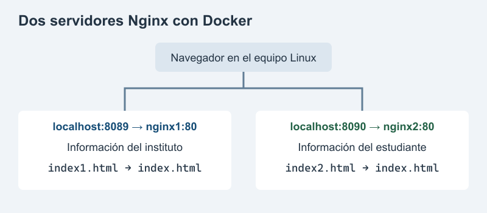
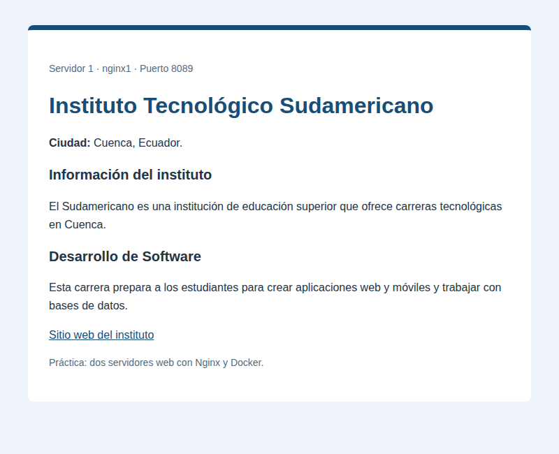
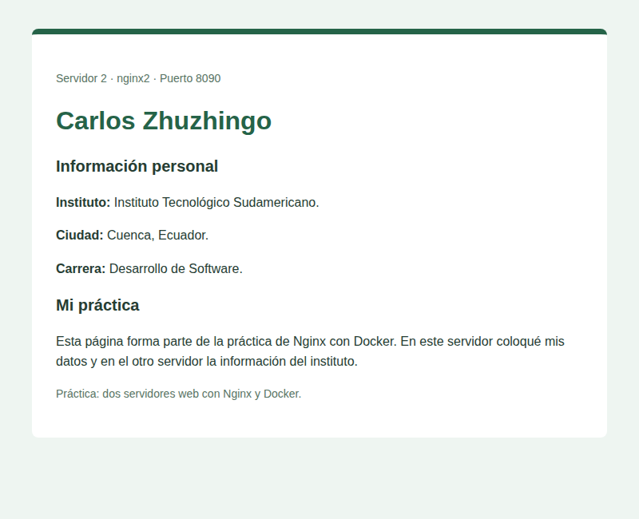
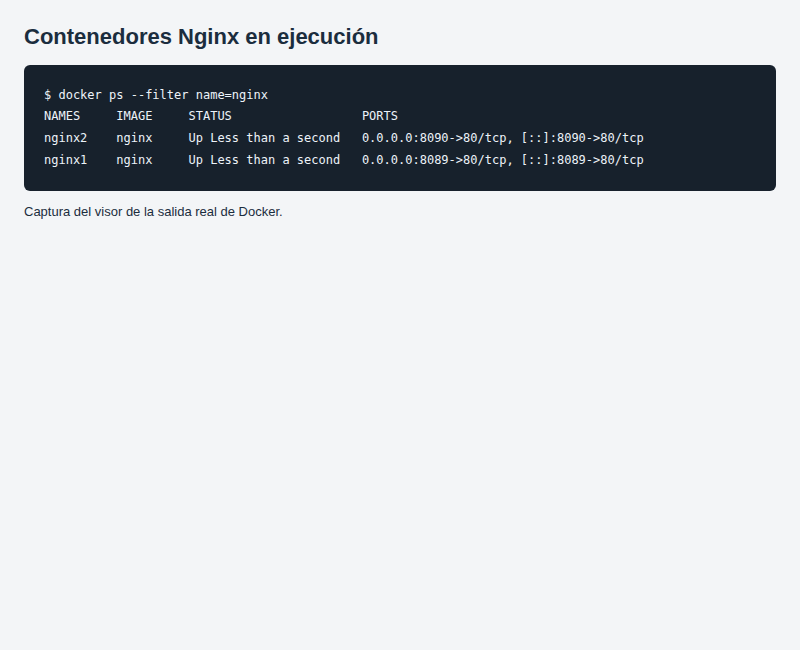

# Práctica No. 1: Dos servidores web con Nginx y Docker

**Nombre:** Carlos Zhuzhingo

**Instituto:** Instituto Tecnológico Sudamericano, Cuenca

**Carrera:** Desarrollo de Software

**Actividad:** Semana 2

**Fecha:** 18 de octubre de 2026

## 1. Título

Crear dos servidores Nginx con Docker y cambiar sus páginas de inicio.

## 2. Tiempo de duración

Tiempo estimado para realizar y revisar la práctica: aproximadamente 30 minutos.

## 3. Fundamentos

Un servidor web permite ver una página desde el navegador. Cuando se escribe una dirección, el navegador pide el contenido y el servidor lo envía. En esta práctica se usa Nginx para mostrar dos páginas distintas: una con información del instituto y otra con los datos del estudiante. El archivo index.html es la página que aparece al abrir cada servidor.

Docker permite ejecutar programas dentro de contenedores. Un contenedor tiene los archivos y herramientas que necesita el programa para funcionar. Para crear los dos servidores se usa la imagen de Nginx. Una imagen sirve como base para crear contenedores, por lo que la misma imagen permite tener nginx1 y nginx2 al mismo tiempo.

Cada contenedor tiene su nombre y sus propios archivos. Esto permite cambiar la página de nginx1 sin cambiar la de nginx2. Aunque los dos se crean con Nginx, pueden mostrar información diferente. En el primero se coloca el nombre del instituto, la ciudad y una descripción de la carrera. En el segundo se escribe el nombre del estudiante, su instituto y su carrera.

Los puertos permiten entrar al servidor que se quiere revisar. Nginx usa el puerto 80 dentro de cada contenedor. En el equipo donde se ejecuta Docker se usa 8089 para nginx1 y 8090 para nginx2. Por eso, al abrir localhost:8089 se ve la información del instituto y al abrir localhost:8090 se ven los datos del estudiante. La palabra localhost se refiere al equipo donde está funcionando Docker.

El comando docker cp permite copiar un archivo desde el contenedor al equipo y también hacer la copia en sentido contrario. Así se puede sacar index.html, editarlo con otro nombre y devolverlo a su ubicación. La carpeta donde Nginx guarda esta página es /usr/share/nginx/html. El archivo que se devuelve debe llamarse index.html para reemplazar la página inicial.

Después de copiar cada archivo editado, se abre su dirección en el navegador para comprobar el cambio. También se usa docker ps para revisar que los dos contenedores estén funcionando y que cada uno tenga el puerto que le corresponde.



*Figura 1. Cada puerto permite abrir un contenedor y ver una página diferente.*

## 4. Conocimientos previos

- Escribir comandos en la terminal.
- Crear y editar un archivo HTML.
- Abrir una dirección en el navegador.
- Subir archivos a GitHub.

## 5. Objetivos a alcanzar

- Crear los contenedores nginx1 y nginx2 con la imagen de Nginx.
- Usar los puertos 8089 y 8090 para ver páginas diferentes.
- Copiar y editar el archivo index.html de cada contenedor.
- Mostrar información del instituto en nginx1 y mis datos en nginx2.

## 6. Equipo necesario

- Un equipo Linux con Docker y Vim.
- Un navegador y conexión a Internet.
- Una cuenta de GitHub.
- Teléfono o micrófono para grabar el audio.

La práctica se ejecutó en Ubuntu 24.04 usando GitHub Actions, porque Docker no estaba instalado en el computador. Los servidores funcionaron durante esa ejecución y sus resultados quedaron guardados en el repositorio.

## 7. Material de apoyo

- Indicaciones de la tarea de la semana 2.
- [Plantilla del informe](https://github.com/maguaman2/informe-tendencias/blob/main/informe.md).
- [Información de la imagen Nginx](https://hub.docker.com/_/nginx).
- [Sitio web del instituto](https://sudamericano.edu.ec/).

## 8. Procedimiento

### Paso 1. Crear los dos contenedores

Creé nginx1 con el puerto 8089 y nginx2 con el puerto 8090.

```bash
docker run -d --name nginx1 -p 8089:80 nginx
docker run -d --name nginx2 -p 8090:80 nginx
```

La opción -d deja el contenedor funcionando. Con --name se le pone un nombre. La opción -p conecta el puerto del equipo con el puerto 80 del contenedor.

### Paso 2. Copiar la página de nginx1 al equipo

```bash
docker cp nginx1:/usr/share/nginx/html/index.html ./index1.html
```

El archivo se guardó como index1.html. Antes de cambiarlo, tenía la página de bienvenida de Nginx.

### Paso 3. Editar la página del instituto

Edité index1.html con Vim. Coloqué el nombre del Instituto Tecnológico Sudamericano, su ciudad y una descripción de la carrera de Desarrollo de Software. El archivo preparado está en [index1.html](index1.html).

Para editarlo a mano se puede abrir con:

```bash
vi index1.html
```

Después de guardar el archivo, lo copié al contenedor:

```bash
docker cp index1.html nginx1:/usr/share/nginx/html/index.html
```

### Paso 4. Repetir el proceso con nginx2

Saqué la página del segundo contenedor:

```bash
docker cp nginx2:/usr/share/nginx/html/index.html ./index2.html
```

Edité index2.html con Vim y coloqué mi nombre, instituto, ciudad y carrera. El archivo preparado está en [index2.html](index2.html). Para abrirlo a mano se puede usar:

```bash
vi index2.html
```

Copié el archivo editado al segundo contenedor:

```bash
docker cp index2.html nginx2:/usr/share/nginx/html/index.html
```

### Paso 5. Revisar los dos servidores

Revisé los contenedores con:

```bash
docker ps
```

En el navegador del equipo Linux abrí estas direcciones:

- http://localhost:8089 para la página del instituto.
- http://localhost:8090 para mi página personal.

En los dos casos se comprobó que el servidor respondiera y que mostrara el archivo correcto. Las órdenes ejecutadas están en [comandos.txt](evidencias/comandos.txt).

## 9. Resultados esperados

Los dos contenedores quedaron funcionando durante la práctica. nginx1 mostró la información del instituto en el puerto 8089 y nginx2 mostró mis datos en el puerto 8090. Las dos páginas respondieron con el estado 200, que indica que se pudieron abrir. La comprobación quedó guardada en la [ejecución de la práctica](https://github.com/CarlosPaul80/tarea-s2-nginx-docker-Carlos-Zhuzhingo/actions/runs/39166011728).



*Figura 2. Captura del navegador en http://localhost:8089, con la información del instituto.*



*Figura 3. Captura del navegador en http://localhost:8090, con los datos de Carlos Zhuzhingo.*



*Figura 4. Captura del visor de la salida real de docker ps.*

Esta práctica permitió ver que dos contenedores pueden usar la misma imagen y mostrar páginas distintas. Para cambiar cada página se copió el archivo, se editó en el equipo y se devolvió al contenedor.

Los enlaces localhost funcionan en el equipo donde se está ejecutando Docker. Para repetir la práctica en otro computador, se deben crear allí los contenedores y copiar las páginas. Las capturas y los archivos del repositorio se pueden revisar aunque esa ejecución ya haya terminado.

## 10. Bibliografía

- Docker, Inc. (s. f.). *docker container cp*. Docker Docs. https://docs.docker.com/reference/cli/docker/container/cp/
- Docker, Inc. (s. f.). *nginx: Docker Official Image*. Docker Hub. https://hub.docker.com/_/nginx
- GitHub. (s. f.). *GitHub-hosted runners*. GitHub Docs. https://docs.github.com/en/actions/concepts/runners/github-hosted-runners
- Instituto Sudamericano. (s. f.). *Desarrollo de Software*. https://sudamericano.edu.ec/?program=desarrollo-de-software
- maguaman2. (s. f.). *informe-tendencias* [Plantilla de informe]. GitHub. https://github.com/maguaman2/informe-tendencias
